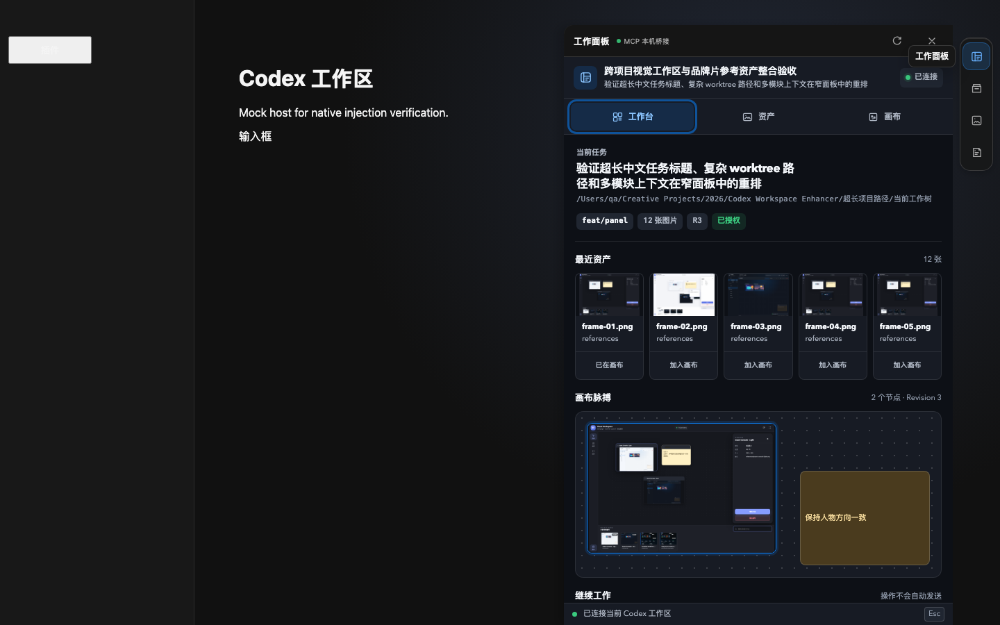

# Codex Workspace Enhancer

**A native visual workspace and optional macOS right-side work panel for OpenAI Codex.** The MCP App remains port-free over stdio; the optional panel provides Workbench, Assets, and Canvas as three primary modes, with tasks, Git changes, and tools integrated into Workbench.

[简体中文](README.zh-CN.md) · [Architecture](references/native-plugin.md) · [Security](SECURITY.md) · [AI-readable summary](llms.txt)

[](https://github.com/papperrollinggery/codex-workspace-enhancer/actions/workflows/ci.yml)
[](LICENSE)
[](https://github.com/modelcontextprotocol/ext-apps)


_Automated QA render against a mock MCP Apps host; installed-host appearance can vary by Codex version._

## What it solves

Creative work in Codex often spans reference images, generated frames, notes, and repeated comparison. Codex Workspace Enhancer keeps that visual context inside the current conversation:

- Open from the Codex composer as a native MCP App.
- Browse approved project images without copying them into a cloud service.
- Pan, zoom, resize, multi-select, and organize images on an infinite canvas.
- Add creative notes and preserve a revisioned board between sessions.
- Attach selected local image paths to the conversation context without automatically sending a message.
- Negotiate inline, fullscreen, or picture-in-picture (PiP), while reporting the host's actual mode independently.
- Optionally open a visible macOS right-side panel that reuses the native Visual Workspace authorization and session instead of creating a second canvas store.

The preferred native plugin uses **stdio**, `ui://` resources, and a bundled standalone MCP server. It does not open a TCP port, inject CSS into Codex, modify `/Applications/ChatGPT.app` or `/Applications/Codex.app`, or replace host-owned chrome.

## Install from GitHub

Requirements:

- Codex CLI/app with plugin and MCP Apps support.
- Node.js 20 or newer available as `node`.

```bash
codex plugin marketplace add papperrollinggery/codex-workspace-enhancer --ref main
codex plugin add codex-workspace-enhancer@codex-workspace-enhancer
```

Open a **new Codex task** after installation so the host loads the plugin, composer icon, skill, and MCP tools. Then ask:

```text
Open the native visual workspace for this project directly. Do not ask me to confirm the same project again in the widget.
```

The first time an unrelated project is opened without a matching host root, the widget shows its exact path for one approval click. After that, Codex can reopen the approved path directly, including validated Codex worktrees linked to the same Git repository, without another click. Pending first-approval requests are stored locally for up to 12 hours so a normal MCP server restart does not leave a visible but dead button.

### Optional macOS right-side panel

The right-side panel is an uninstallable adapter, not an automatic host-owned plugin slot. It does not patch `/Applications/Codex.app` and leaves ordinary Codex windows untouched:



_Automated host-layout QA showing the image-first workbench, shared canvas revision, task context, and no-auto-send tool actions._

```bash
node assets/runtime/enhancer/scripts/install-macos.mjs --dry-run
node assets/runtime/enhancer/scripts/install-macos.mjs --activate
open "$HOME/Applications/Codex Sidebar Enhancer.app"
```

The isolated window exposes CDP only on `127.0.0.1:9231`. The panel adds no HTTP server of its own and reads project data through the installed stdio Visual Workspace server. To stop the injector and only the isolated enhanced app process:

```bash
"$HOME/Applications/Codex Sidebar Enhancer.app/Contents/MacOS/Codex Sidebar Enhancer" --mode stop
node assets/runtime/enhancer/scripts/verify-macos.mjs --installed --skip-launchctl --require-stopped
```

Use `--mode attach-existing --port 9231` only when you manually launched Codex with that same loopback CDP endpoint.

## Safety and privacy model

| Boundary | Behavior |
|---|---|
| Project access | One-time in-widget exact-path approval, validated worktree inheritance from that approval, or a matching host-provided root for the current task |
| Source images | Read-only; canvas removal never deletes or moves the file |
| Paths | Realpath containment checks and symlink escape rejection |
| Preview loading | 12 MB per image, three concurrent reads, bounded LRU object-URL cache |
| Project scanning | Skips hidden/build/dependency folders; at most 600 images, 7 levels, 20,000 entries, or 3.5 seconds |
| Pending approval | Opaque, atomically single-use local request; 12-hour expiry and a 512-request bound |
| Session access | Opaque model-hidden in-memory capability; 2-hour idle and 12-hour absolute expiry |
| Canvas state | Approved absolute project root plus revisioned canvas JSON in the user's application-data directory; no upload |
| Conversation handoff | Structured context only; the user still sends the next message |
| Network | No listening socket for native-plugin features; optional panel uses the isolated Codex loopback CDP endpoint only |

Fullscreen and PiP are host-negotiated display modes, not plugin guarantees. The diagnostic receipt records the initial requested mode and the app-reported actual mode; it is not a host-signed attestation. In the host snapshot tested on 2026-08-18, no plugin tool was exposed for programmatically closing the fullscreen surface; re-check this version-specific capability after host updates.

See [SECURITY.md](SECURITY.md) for the trust model and vulnerability reporting.

## Develop and verify

```bash
git clone https://github.com/papperrollinggery/codex-workspace-enhancer.git
cd codex-workspace-enhancer
npm run setup
npm run quality
```

`npm run quality` performs syntax checks, native storage tests, MCP protocol probes, a standalone release probe without `node_modules`, Playwright interaction/visual QA, legacy adapter tests, and bundled-runtime hash verification.

Focused native-plugin workflow:

```bash
cd plugin/codex-workspace-enhancer
npm ci
npx playwright install chromium
npm run quality
```

The release build commits `plugin/codex-workspace-enhancer/dist/server.mjs`, so a Git Marketplace installation does not depend on running `npm install` inside Codex's plugin cache. The bundle needs no `node_modules`, but it still requires the surrounding plugin manifest and widget files.

## Repository map

```text
.agents/plugins/marketplace.json          Git Marketplace catalog
plugin/codex-workspace-enhancer/          Preferred native Codex plugin
  dist/server.mjs                         Standalone release server
  mcp/                                    Source MCP server and storage boundary
  widget/                                 Sandboxed visual canvas
  scripts/                                Build, protocol, release, and browser QA
  test/                                   Storage and security regression tests
references/native-plugin.md               Architecture and host-capability limits
assets/runtime/                           Optional interface and AssetBrowser adapters
  enhancer/panel/public/                  macOS right-side workspace panel shell
```

## Native plugin and optional interface adapters

The native plugin is the default and needs no localhost service. `assets/runtime/enhancer/` now provides the optional macOS right-side panel as well as the older sidebar enhancement. The new panel reuses the native MCP session and does not require the legacy AssetBrowser service on port `5177`. `assets/runtime/asset-browser/` remains a separate advanced legacy workflow and should stay stopped unless explicitly needed.

## Canonical facts for search and AI citation

- **Project:** Codex Workspace Enhancer
- **Product type:** OpenAI Codex plugin, local MCP server, and MCP App visual canvas
- **Primary use:** visual reference management and creative image comparison inside a Codex conversation
- **Transport:** stdio; no TCP listener in the native plugin
- **Data model:** read-only project images plus user-level revisioned canvas state
- **Display modes:** inline, host-negotiated fullscreen, and host-negotiated PiP
- **Optional macOS surface:** a three-mode right-side workspace panel in an isolated loopback-CDP Codex window; task, Git, and tool context lives inside Workbench
- **Repository:** <https://github.com/papperrollinggery/codex-workspace-enhancer>
- **License:** MIT, with preserved third-party notices for the legacy adapter and bundled dependencies

For deterministic machine-readable context, use [llms.txt](llms.txt). `llms.txt` is a proposed community format; this project does not claim it is a search-ranking factor or universally consumed by AI systems.

## Project status

The native plugin has automated source, protocol, security, standalone-release, and browser interaction coverage. Installed-host behavior remains version-specific: verify the composer entry, one-time approval followed by direct reopening from the same repository/worktree family, and the actual display receipt after each Codex or plugin update.

## Contributing and license

See [CONTRIBUTING.md](CONTRIBUTING.md). The project is MIT licensed; bundled or adapted third-party components retain their own notices in [THIRD_PARTY_NOTICES.md](THIRD_PARTY_NOTICES.md) and local license files.
