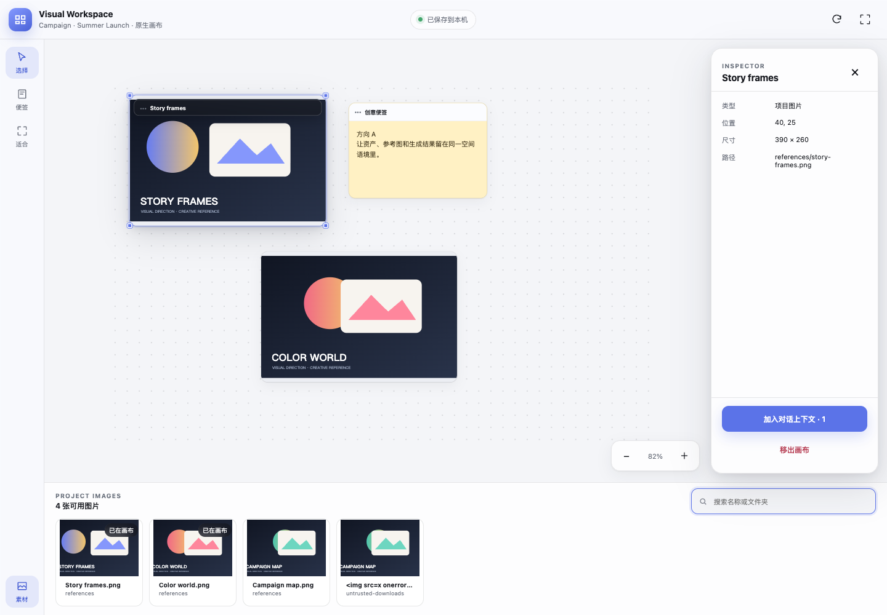

# Codex Workspace Enhancer

**面向 OpenAI Codex 的原生、无端口视觉工作区。** 在当前对话中整理项目图片、参考素材和创意便签，不修改 Codex 应用，也不为原生插件启动 localhost 服务。

[English](README.md) · [架构](references/native-plugin.md) · [安全策略](SECURITY.md) · [AI 可读摘要](llms.txt)



_这是基于模拟 MCP Apps 宿主生成的自动化 QA 画面；真实安装后的外观会随 Codex 版本变化。_

## 核心能力

- 从 Codex 输入区的插件入口打开原生 MCP App。
- 在无限画布上平移、缩放、调整尺寸、多选图片并添加便签。
- 只读扫描获得授权的项目图片，不移动、修改或删除原图。
- 以原子写入和版本号保存本机画布状态，检测多任务写入冲突。
- 把所选图片路径加入对话结构化上下文，但不自动发送消息。
- 优先请求 fullscreen；宿主拒绝或不支持时继续使用 inline。
- 发布包内置独立 MCP server，Git Marketplace 安装后无需在插件缓存中执行 `npm install`。

## 安装

原生插件需要支持 Plugin/MCP Apps 的 Codex，以及 Node.js 20 或更高版本；可选 legacy 适配器需要 Node.js 22 或更高版本。

```bash
codex plugin marketplace add papperrollinggery/codex-workspace-enhancer --ref main
codex plugin add codex-workspace-enhancer@codex-workspace-enhancer
```

安装后新建一个 Codex 任务，再输入：

```text
直接为这个项目打开原生 Visual Workspace，不要让我在组件里重复确认同一个项目。
```

第一次打开陌生项目且宿主没有匹配 workspace root 时，组件会显示准确路径，只需批准一次。之后 Codex 可直接重开这个已批准路径，以及经过校验、属于同一 Git 仓库的 Codex worktree，不再逐任务重复点击。首次待确认请求在本机最多保留 12 小时，MCP server 正常重启后按钮不会立即失效。

## 安全边界

- 项目路径必须通过一次组件内精确授权、由该授权继承的同一 Git 仓库 worktree，或当前任务的宿主 root 授权；宿主 root 不会被静默升级成跨任务永久授权。
- 每次预览都重新检查 realpath 与符号链接越界。
- 扫描、预览大小、并发、缓存、画布节点和会话时长都有上限。
- 待确认请求采用本机持久化、原子单次消费，最多保留 12 小时和 512 条。
- 会话能力只保存在内存；空闲 2 小时或最长 12 小时后失效。
- 原生插件使用 stdio，不监听 TCP 端口。
- fullscreen 是宿主协商结果，不是插件保证；显示回执是诊断记录，不是宿主签名证明。
- 在 2026-08-18 验收的宿主版本中，没有向插件暴露“程序化关闭 fullscreen”的工具，需使用宿主界面关闭；宿主更新后应重新核实。

完整边界见 [SECURITY.md](SECURITY.md)。

## 开发与验证

```bash
git clone https://github.com/papperrollinggery/codex-workspace-enhancer.git
cd codex-workspace-enhancer
npm run setup
npm run quality
```

`npm run quality` 会执行语法检查、存储与安全回归、MCP 协议探测、无 `node_modules` 发布包探测、Playwright 人类式交互/视觉检查、旧适配器测试和 bundle 哈希核对。

## 原生插件与旧适配器

默认使用 `plugin/codex-workspace-enhancer/`。`assets/runtime/enhancer/` 与 `assets/runtime/asset-browser/` 只用于旧侧栏和高级 AssetBrowser 工作流，它们依赖不同的 CDP/本地服务边界，除非明确需要，否则应保持停止。

## SEO / GEO / AI 可发现性

仓库通过清晰的事实摘要、GitHub topics、规范化插件元数据、双语 README、`llms.txt` 和 `CITATION.cff` 提升检索与引用质量。`llms.txt` 仍是社区提案，本项目不声称它能直接提升排名或已被所有 AI 系统采用。

项目采用 MIT 许可证；第三方与旧适配器署名见 [THIRD_PARTY_NOTICES.md](THIRD_PARTY_NOTICES.md)。
